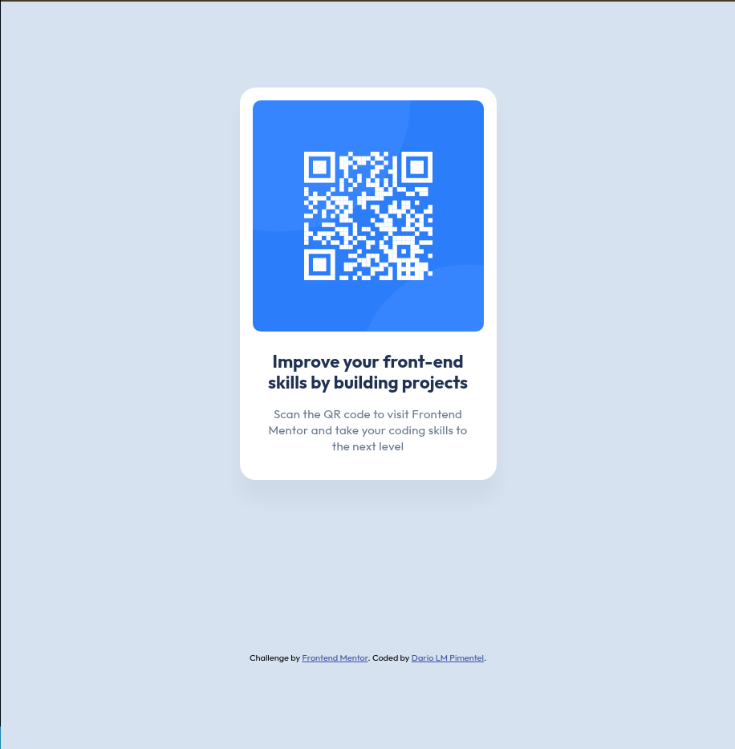

# QR code component

Uma solução para o desafio [QR code component](https://www.frontendmentor.io/challenges/qr-code-component-iux_sIO_H) do Frontend Mentor.

## Visão geral

O objetivo deste projeto foi criar um cartão responsivo com um código QR, seguindo os designs para desktop e mobile fornecidos pelo desafio.

### Preview



## Tecnologias utilizadas

- HTML5 semântico
- CSS3
- CSS Grid
- CSS Flexbox
- Google Fonts - Outfit

## O que aprendi

Durante o desenvolvimento, pratiquei:

- criação de uma estrutura HTML semântica;
- uso de `h1`, parágrafos e texto alternativo em imagens;
- centralização de elementos com CSS Grid;
- organização de um cartão com Flexbox;
- uso de `padding`, `margin`, `border-radius` e `box-shadow`;
- criação de um layout que se adapta a telas pequenas;
- comparação do resultado com designs de referência.

## Estrutura do projeto

```text
.
├── index.html
├── styles.css
├── images/
│   ├── favicon-32x32.png
│   └── image-qr-code.png
└── design/
    ├── desktop-design.jpg
    ├── mobile-design.jpg
    ├── preview.jpg
    └── screenshot.png
```

## Como executar

1. Clone ou baixe este repositório.
2. Abra o arquivo `index.html` no navegador.

Também é possível usar a extensão Live Server no Visual Studio Code para visualizar as alterações automaticamente.

## Créditos

- Desafio: [Frontend Mentor](https://www.frontendmentor.io)
- Desenvolvedor: Dario LM Pimentel
